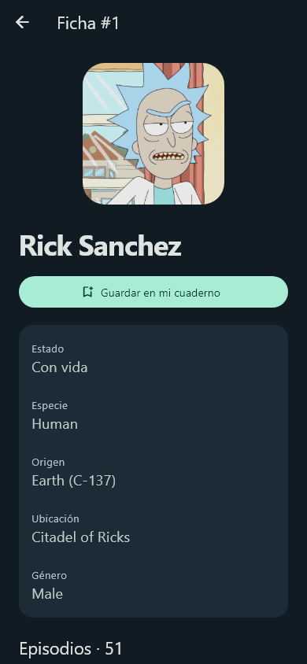

# Atlas del multiverso

Cuaderno de campo para buscar personajes de Rick and Morty y consultar fichas guardadas durante una expedición. Cada número de celular tiene su propia colección en el dispositivo.

 

## Probar la aplicación

1. Abre Atlas y escribe un celular mexicano de 10 dígitos con lada, por ejemplo `833 123 4567`. Si pegas `+52 833 123 4567`, se abre el mismo cuaderno. El acceso es una simulación local. Cualquier persona que conozca el número puede abrir ese cuaderno.
2. Busca **Morty**, abre una ficha y pulsa **Guardar en mi cuaderno**. La ficha incluye estado, especie, origen, ubicación y números de episodio. Los valores de catálogo conservan los nombres de la fuente.
3. Abre **Guardados**, activa modo avión y vuelve a iniciar Atlas. La sesión, la pestaña y las fichas se leen de SQLite. Un retrato descargado también puede consultarse sin señal. Si la descarga falló, aparece una silueta.
4. Usa **Cambiar investigador** en la barra superior. Abre otro número y comprueba su colección. Al regresar al primero se recupera su espacio de trabajo.

## Desarrollo

Entorno utilizado: Flutter 3.35.7, Dart 3.9, JDK 17 y Android SDK. La configuración de Android especifica el NDK 28.2.13676358. Con un dispositivo Android o emulador disponible:

```sh
flutter pub get
flutter run
flutter analyze
flutter test
flutter build apk --release
```

Flutter deja el APK en `build/app/outputs/flutter-apk/app-release.apk`. El paquete es `dev.cartografia.atlas`. La compilación de evaluación usa la firma de desarrollo.

## Datos y recuperación

- **Catálogo.** La búsqueda consulta la API pública por nombre y página. Espera una pausa breve al escribir y descarta respuestas de búsquedas anteriores. Una página adicional se solicita al pulsar **Cargar más**.
- **Conexión.** El resultado de la consulta determina la disponibilidad del catálogo. Un 404 de la búsqueda indica que no hay coincidencias. Si la petición falla, se conservan las páginas ya visibles o se ofrecen coincidencias guardadas por el investigador. Cuando Android informa que recuperó internet o la app vuelve al primer plano, se reintenta la página pendiente. También se puede reintentar desde el catálogo.
- **Cuaderno.** Guardar y quitar son operaciones locales. La clave compuesta por celular y personaje evita duplicados. El texto queda disponible aun si el retrato no termina de descargarse. La API publica un catálogo de lectura, por lo que los cambios del cuaderno no necesitan una cola de envíos.
- **Continuidad.** Se conserva la última búsqueda, pestaña y ficha abierta de cada investigador. Borrar los datos de Android elimina las sesiones y las colecciones locales.
- **Interfaz.** Durante el arranque, Flutter anima el emblema mientras SQLite recupera la sesión. La cuadrícula crea las tarjetas conforme entran en pantalla. Las primeras seis aparecen en secuencia y comparten el retrato con la ficha al abrirla. El arrastre termina la secuencia. Con movimiento reducido, el contenido aparece directamente.

La identificación usa una copia local del patrón de numeración móvil de México. Al actualizar desde la versión 1.0, SQLite reúne las fichas de los cuadernos que corresponden al mismo celular. Si ambos tenían la misma ficha, conserva el retrato disponible. Se da prioridad a la vista del cuaderno activo. Las claves antiguas que no corresponden a un celular mexicano se conservan en la base sin asociarlas a otra persona. [Metadatos de numeración de México, libphonenumber v9.0.44](https://github.com/google/libphonenumber/blob/v9.0.44/resources/PhoneNumberMetadata.xml)

Las fichas sin retrato forman una cola local de descargas pendientes. Una consulta exitosa reactiva la lectura en lotes de ocho y descarga una imagen por turno. La selección del investigador queda confirmada antes de descargarla.

## Organización

`lib/atlas_data.dart` contiene el cliente HTTP, el modelo de personaje y las operaciones SQLite. `main.dart` recupera la sesión. `entry.dart`, `field_desk.dart` y `details.dart` contienen acceso, catálogo y ficha. La cuadrícula está en `catalog.dart`, la secuencia de arranque en `motion.dart` y el emblema en `appearance.dart`.

Las pruebas de SQLite cierran y vuelven a abrir la base para verificar persistencia, separación de cuadernos y referencias duplicadas. Las pruebas de interfaz cubren el acceso, el guardado sin retrato, el arranque, el orden de entrada de las tarjetas y la recuperación de una página cuando vuelve la red.

## Referencias

[Contrato de la API pública](https://rickandmortyapi.com/documentation) · [Persistencia y recuperación offline en Flutter](https://docs.flutter.dev/app-architecture/design-patterns/offline-first) · [Pantalla de lanzamiento de Android](https://docs.flutter.dev/platform-integration/android/splash-screen) · [Animaciones escalonadas en Flutter](https://docs.flutter.dev/ui/animations/staggered-animations)


