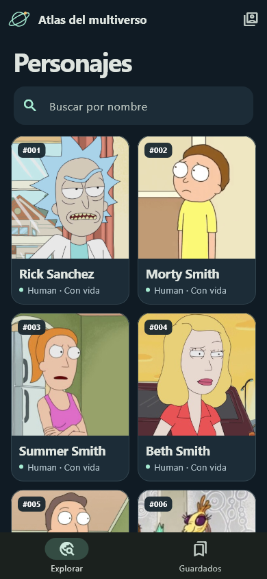

# Atlas del multiverso

Atlas es una app para Android que permite buscar personajes de Rick and Morty y guardar sus fichas para consultarlas sin conexión. Cada número de celular tiene su propio cuaderno en el dispositivo.

 

## El catálogo y el cuaderno

El catálogo reúne los personajes de Rick and Morty. La búsqueda es por nombre y cada ficha muestra el estado, la especie, el origen y la ubicación. Los números de episodio indican en cuáles aparece el personaje.

En **Guardados**, las fichas siguen disponibles en modo avión, incluso después de cerrar y volver a abrir Atlas. Los retratos que ya se descargaron se conservan junto con la ficha. Mientras se descarga un retrato, aparece una silueta.

Atlas identifica cada cuaderno por un número mexicano de 10 dígitos, incluida la lada. `833 123 4567` y `+52 833 123 4567` llevan al mismo cuaderno. La identificación se resuelve en el dispositivo, sin SMS. **Cambiar investigador** abre el acceso a otro cuaderno.

## Desarrollo

El proyecto se compiló con Flutter 3.35.7, Dart 3.9, JDK 17 y Android SDK. Gradle usa el NDK 28.2.13676358. La ejecución local se hace en Android físico o en un emulador.

```sh
flutter pub get
flutter run
flutter analyze
flutter test
flutter build apk --release
```

Flutter deja el APK en `build/app/outputs/flutter-apk/app-release.apk`. El paquete es `dev.cartografia.atlas`. El APK de entrega lleva la firma de desarrollo.

## Datos y recuperación

Atlas espera una pausa breve al escribir antes de consultar la API y descarta las respuestas de búsquedas anteriores. **Cargar más** pide la página siguiente. Si esa petición falla, los resultados anteriores siguen visibles. Si falla la primera página, aparecen las fichas guardadas que coinciden con la búsqueda. El catálogo ofrece un reintento y vuelve a intentar la consulta cuando regresa la conexión o la app vuelve al primer plano.

SQLite conserva la sesión, la última vista y los guardados de cada investigador. Cada personaje se guarda una sola vez por cuaderno, aunque el retrato todavía esté pendiente. Las descargas pendientes se retoman cuando vuelve la conexión o después de una consulta exitosa al catálogo. Atlas lee hasta ocho pendientes por lote y procesa un retrato a la vez desde la cola.

La actualización desde la versión 1.0 reúne los guardados de los cuadernos que usaban el mismo celular con y sin +52. Si una ficha estaba en ambos, la migración conserva el retrato disponible. La vista del cuaderno activo tiene prioridad. Las claves antiguas que no corresponden a un celular mexicano quedan en la base de datos. [Metadatos de numeración de México, libphonenumber v9.0.44](https://github.com/google/libphonenumber/blob/v9.0.44/resources/PhoneNumberMetadata.xml)

## Arranque y catálogo

El emblema se anima mientras SQLite recupera la sesión. La cuadrícula carga las tarjetas conforme entran en pantalla. En la primera presentación, las seis primeras aparecen una tras otra. La secuencia termina al desplazar la cuadrícula. Al abrir una ficha, el retrato acompaña la transición. Con el ajuste de movimiento reducido, las tarjetas aparecen directamente.

## Código y pruebas

- `lib/atlas_data.dart` reúne el cliente HTTP, el modelo de personaje y las operaciones de SQLite. `lib/main.dart` recupera la sesión.
- `lib/entry.dart`, `lib/field_desk.dart` y `lib/details.dart` contienen las pantallas de acceso, catálogo y ficha. La cuadrícula está en `lib/catalog.dart` y el arranque en `lib/motion.dart`, con el emblema de `lib/appearance.dart`.

Las pruebas de SQLite revisan la persistencia al reabrir la base, la separación de cuadernos y la migración de duplicados. Las de interfaz cubren el acceso, el guardado sin retrato, el arranque, la entrada de las tarjetas y el reintento al volver la conexión.

## Referencias

[Contrato de la API pública](https://rickandmortyapi.com/documentation) · [Persistencia y recuperación offline en Flutter](https://docs.flutter.dev/app-architecture/design-patterns/offline-first) · [Pantalla de lanzamiento de Android](https://docs.flutter.dev/platform-integration/android/splash-screen) · [Animaciones escalonadas en Flutter](https://docs.flutter.dev/ui/animations/staggered-animations)
